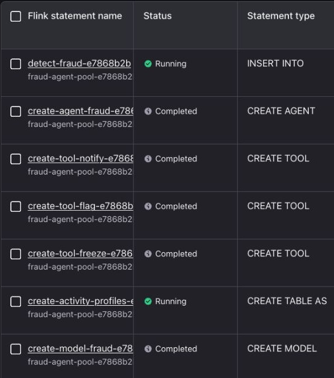
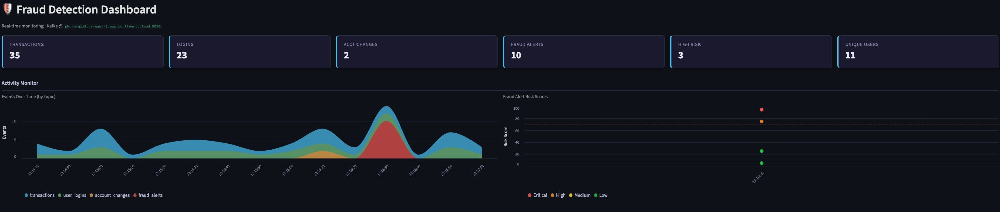

# 🎬 Demo Path — One-Command Deploy

The fastest way to see the system: Terraform provisions **everything** — infrastructure
*and* the full Flink AI pipeline — and you just run the producer and dashboard. For the
hands-on version where you build the AI pipeline yourself, see [`WORKSHOP.md`](WORKSHOP.md).

> Complete the shared [Prerequisites](README.md#prerequisites) first (Confluent Cloud and the
> required tools — AWS Bedrock credentials only if you deploy with `--bedrock`).

## 1. Clone the repository

```bash
git clone https://github.com/confluentinc/demo-confluent-fraud-agent.git && cd demo-confluent-fraud-agent
```

## 2. Deploy everything

```bash
uv run deploy
```

The first run asks for your Confluent Cloud login and a Cloud API key (it can generate one for
you). The agent's Claude model is CSP Hosted by Confluent, so no AWS key is needed; run
`uv run deploy --bedrock` instead to use your own AWS Bedrock key (it detects credentials
already in your shell). It saves them to `credentials.env` (gitignored), so later runs only ask you to confirm.

These are the **only** inputs. Region (`us-east-1`), the Claude model, resource names, and
sizing are all preset.

Deploy provisions the environment, Kafka cluster, Schema Registry, Flink compute pool, the
model (plus a Bedrock connection with `--bedrock`), the UDF tools (JAR upload + functions + tools), the agent,
and the detection query — and writes a ready-to-use `.env` for the local apps. It takes about
10 minutes.

After deployment, open **Flink → Statements** in the new environment. The model,
tools, and agent should be **Completed**; `create-activity-profiles-…` and
`detect-fraud-…` should be **Running**.



## 3. Start the producer and dashboard

When deploy finishes it offers to start both for you: the producer streams in the background
(log: `tmp/producer.log`) and the dashboard opens at http://localhost:8501.

To start them yourself, run each in its own terminal:

```bash
uv run producer
```

```bash
uv run dashboard
```

Watch fraud alerts appear in real time — the injected scenarios surface as high-risk alerts
(scores ~75–95) with `freeze_account` / `flag_transaction` actions and the flagged
transaction ids.

> [!NOTE]
> The dashboard reads from `latest`, so keep the producer running and allow ~1 minute for
> the first window-firing batch of alerts. Inspect the running statements and tables in the
> [Flink workspace](https://confluent.cloud/go/flink).



## Next: the guided walkthrough

Deployed and running? Follow the **[guided walkthrough → `WALKTHROUGH.md`](WALKTHROUGH.md)** —
a ~15-minute, screenshot-by-screenshot tour through **Stream Lineage** (source topics → the
Flink Streaming Agent with union, tools & AI agent → the alerts topic) and finishing on the
live dashboard.

## Cleanup

```bash
uv run destroy
```
