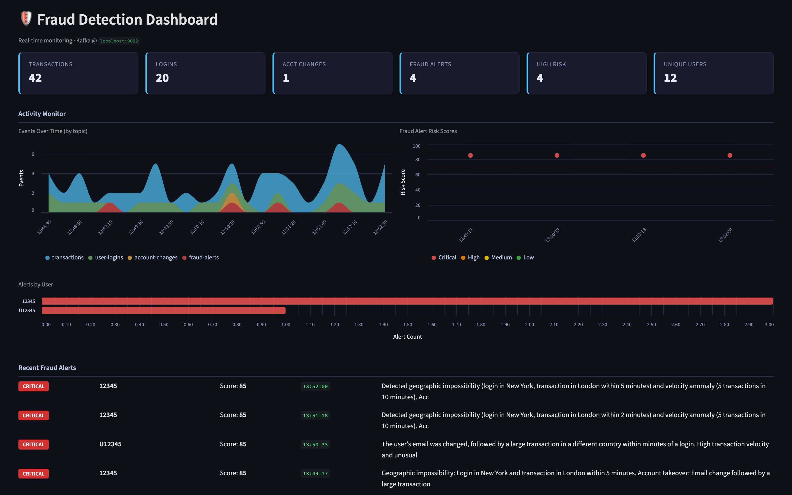
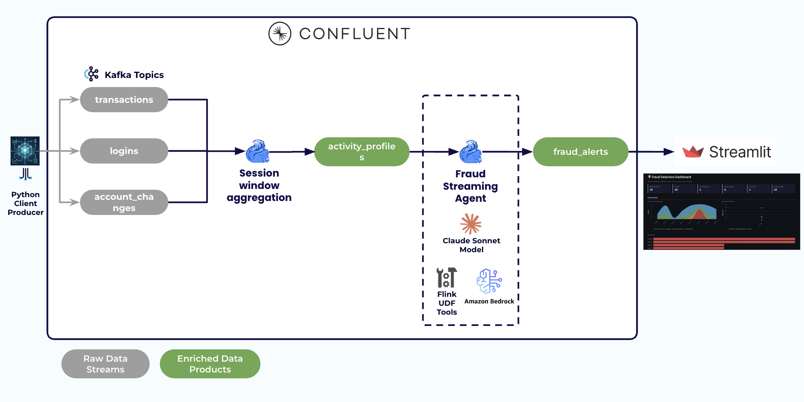

# Real-Time Fraud Detection with Confluent Intelligence Streaming Agents

[](https://www.confluent.io/confluent-cloud/tryfree/?utm_campaign=tm.plg_cd.techxchange2026&utm_source=lab&utm_medium=github)

<div align="center">
  
</div>

Build a real-time fraud detection system with [Confluent Cloud Streaming Agents](https://docs.confluent.io/cloud/current/ai/streaming-agents/overview.html). Streaming user activity is windowed with **Confluent Cloud for Apache Flink** and analyzed by a **Streaming Agent** (Confluent Intelligence) backed by **Claude** (CSP Hosted by Confluent by default, or your own AWS Bedrock with `--bedrock`), which reasons over each user's behavior, calls tools, and emits fraud alerts in real time. A local Python producer generates synthetic events and a local Streamlit dashboard visualizes the results.

Everything except the producer and dashboard runs in Confluent Cloud — there is no local Kafka or Flink.

<table>
<tr>
<th width="25%">Stage</th>
<th width="75%">What happens</th>
</tr>
<tr>
<td><strong>1 · Ingest</strong></td>
<td>A producer streams synthetic <code>transactions</code>, <code>user_logins</code>, and <code>account_changes</code> (~80% normal, ~20% fraud: geo-impossible travel, account takeover, velocity).</td>
</tr>
<tr>
<td><strong>2 · Window</strong></td>
<td>Flink SQL <code>UNION ALL</code>s the three streams, keys by <code>user_id</code>, and collects each user's activity into a 3-second event-time <code>SESSION</code> window — one clean profile per activity burst.</td>
</tr>
<tr>
<td><strong>3 · Reason &amp; act</strong></td>
<td><code>AI_RUN_AGENT</code> runs a <code>CREATE AGENT</code> Streaming Agent (Claude) over each profile. It scores the activity and calls function tools — <code>flag_transaction</code>, <code>freeze_account</code>, <code>notify_user</code> — during its reasoning.</td>
</tr>
<tr>
<td><strong>4 · Alert</strong></td>
<td>The agent's JSON verdict (risk score, reasoning, actions, flagged ids) is written to the <code>fraud_alerts</code> topic and rendered live on the Streamlit dashboard.</td>
</tr>
</table>



## Prerequisites

**Required accounts & credentials:**

- **A Confluent Cloud account** + a **Cloud resource management** API key & secret ([create one](https://docs.confluent.io/cloud/current/security/authenticate/workload-identities/service-accounts/api-keys/manage-api-keys.html)).
  [](https://www.confluent.io/confluent-cloud/tryfree/?utm_campaign=tm.plg_cd.techxchange2026&utm_source=lab&utm_medium=github)
- **No AWS account by default.** The agent runs on Claude through Confluent's **CSP Hosted model inference** (`'provider' = 'confluent'`), so there are no model keys to manage.
- *Only with `uv run deploy --bedrock`* (your own Bedrock keys instead): **an AWS account with Amazon Bedrock access** — an IAM user with a long-lived access key & secret and the `bedrock:InvokeModel` permission — and **Claude model access enabled in Amazon Bedrock** (region **`us-east-1`**). Bedrock does **not** enable third-party models by default — request/enable Anthropic Claude on the **Model access** page once. See [Add or remove access to Amazon Bedrock foundation models](https://docs.aws.amazon.com/bedrock/latest/userguide/model-access.html). Without this, deploy succeeds but no alerts are produced (Bedrock returns AccessDenied).

**Required tools:**

- **[Terraform](https://github.com/hashicorp/terraform)**
- **[Git](https://git-scm.com/)**
- **[uv](https://docs.astral.sh/uv/getting-started/installation/)** (installs Python and the dependencies for you)
- **[Confluent CLI](https://docs.confluent.io/confluent-cli/current/install.html)**

<details>
<summary>Installation commands (Mac / Windows)</summary>

**Mac (Homebrew):**

```bash
brew install git uv confluentinc/tap/cli && brew tap hashicorp/tap && brew install hashicorp/tap/terraform
```

**Windows (winget, PowerShell):**

```powershell
winget install Git.Git astral-sh.uv ConfluentInc.Confluent-CLI Hashicorp.Terraform
```

**Optional — maintainers only, to rebuild the UDF JAR:**

```bash
# Mac
brew install colima docker && colima start
```
```powershell
# Windows
winget install Docker.DockerDesktop
```
</details>

## Choose your path

This repo can be run two ways. Both start from the same [Prerequisites](#prerequisites) above.

| Path | What you do | Time | Guide |
|------|-------------|------|-------|
| **🎬 Demo** | One `uv run deploy` deploys **everything** — infra *and* the full Flink AI pipeline. You just run the producer and dashboard. | ~15 min | **[DEMO.md](DEMO.md)** |
| **🛠️ Self-service workshop** | `uv run deploy --workshop` deploys infra + the 4 tables; **you build the AI pipeline by hand** in the Flink UI (producer + input topics → windowing → model → tools → agent → detection → dashboard). | ~1 hour | **[WORKSHOP.md](WORKSHOP.md)** |

**New here or short on time?** Take the [Demo path](DEMO.md). **Want to learn how Streaming
Agents are built, statement by statement?** Take the [Workshop path](WORKSHOP.md).

## Directory Structure

```
demo-confluent-fraud-agent/
├── DEMO.md                          # Demo path — one-command deploy
├── WORKSHOP.md                      # Self-service workshop — manual Flink SQL
├── WALKTHROUGH.md                   # Guided post-deploy Stream Lineage tour
├── terraform/                       # Confluent Cloud provisioning (start here)
│   ├── main.tf                      # Env, cluster, SR, compute pool, service account, keys, ACLs
│   ├── flink.tf                     # LLM provider switch, tools artifact, and all Flink statements
│   ├── connect.tf                   # Writes .env for the local apps
│   ├── variables.tf                 # Confluent key/secret, llm_provider (+ Bedrock keys), deploy_flink_pipeline
│   └── modules/flink-statement/     # Reusable confluent_flink_statement wrapper
├── tools-udf/                       # Java UDF tools (flag/freeze/notify) + pre-built JAR
├── producer/generate_events.py      # Synthetic event generator
├── dashboard/app.py                 # Streamlit real-time dashboard
├── scripts/                         # `uv run` commands: deploy, destroy, dashboard, setup-mcp, setup-rtce, api-keys, test-bedrock
└── pyproject.toml                   # Dependencies + `uv run` entry points
```

## How the agent's tools work

The agent calls three function-based tools — `flag_transaction`, `freeze_account`, `notify_user` — implemented as Flink UDFs in `tools-udf/` and uploaded as a Flink artifact. They are **mock** actions (each returns a confirmation string, no real side effect) but are genuinely invoked by the agent during tool-calling. To change them, edit the Java sources and rebuild with `tools-udf/build.sh` (uses Docker — no host Java toolchain needed), then commit the new JAR. Rebuilding is a maintainer task; running the demo never requires it.

## Troubleshooting

**Dashboard shows no fraud alerts?** The input topics and `activity_profiles` fill but `fraud_alerts` stays empty — check, in order:

1. **Model access.** With the default CSP Hosted model, check the `create-model-fraud-…` statement is `COMPLETED`. With `--bedrock`, if Claude isn't enabled in **Amazon Bedrock → Model access (us-east-1)**, every `AI_RUN_AGENT` call fails with AccessDenied and no alerts are produced. Enable it (see Prerequisites).
2. **Is the `detect-fraud` statement RUNNING?** In the [Flink workspace](https://confluent.cloud/go/flink), check the `detect-fraud-…` statement isn't `FAILED`. The agent is configured with `handle_exception = 'continue'` and `max_consecutive_failures = '5'` so a stray malformed model response doesn't kill it — if it still fails, inspect the statement's error detail.
3. **Give it ~1–2 minutes** with the producer running. The dashboard reads from `latest`; alerts arrive in window-firing batches and high-risk ones are ~1 per cycle.

Verify the stages directly in the Flink workspace:
```sql
SELECT * FROM activity_profiles;            -- should fill (windowing works)
SELECT * FROM fraud_alerts WHERE risk_score >= 70;   -- the high-risk verdicts
```

**A workshop `CREATE` (`activity_profiles`, the model, a tool, or the agent) fails with "already exists"?**
You deployed in demo mode first: that created the pipeline objects, and they stay in the Flink
catalog after the statements are removed. Re-run `uv run deploy --workshop` and answer `y` when it
offers to destroy and redeploy (or run `uv run destroy`, then `uv run deploy --workshop`).

## Utility commands

| Command | What it does |
|---------|--------------|
| `uv run deploy` | Prompts for credentials (saved to the gitignored `credentials.env`), then deploys. `--workshop` skips the hands-on AI pipeline statements; `--bedrock` backs the agent with your own AWS Bedrock keys instead of CSP Hosted inference. |
| `uv run producer` | Streams synthetic events (Ctrl+C to stop). |
| `uv run dashboard` | Opens the live dashboard at http://localhost:8501. |
| `uv run setup-mcp` | Registers the [Confluent MCP server](https://github.com/confluentinc/mcp-confluent) with Claude Code or Codex for this deployment, so your coding agent can list topics and run Flink SQL. Needs Node.js. |
| `uv run setup-rtce` | Enables [Real-Time Context Engine](https://docs.confluent.io/cloud/current/ai/real-time-context-engine.html) on the demo topics and registers its MCP server with your coding agent. Not used by the demo yet. |
| `uv run test-bedrock` | `--bedrock` only: checks the AWS key in `credentials.env` can invoke Claude on Bedrock. |
| `uv run api-keys create` / `destroy` | Workshop organizers using `--bedrock`: mint (or revoke) a Bedrock-only AWS IAM key. |
| `uv run destroy` | Tears everything down. |

## Cleanup

```bash
uv run destroy
```

This removes the entire Confluent Cloud environment (cluster, topics, schemas, Flink resources) in one step.

## Sign up for early access to Flink AI features

For early access to new Flink AI features, [fill out this form](https://events.confluent.io/early-access-flink-features) and we'll add you to our early access previews.
